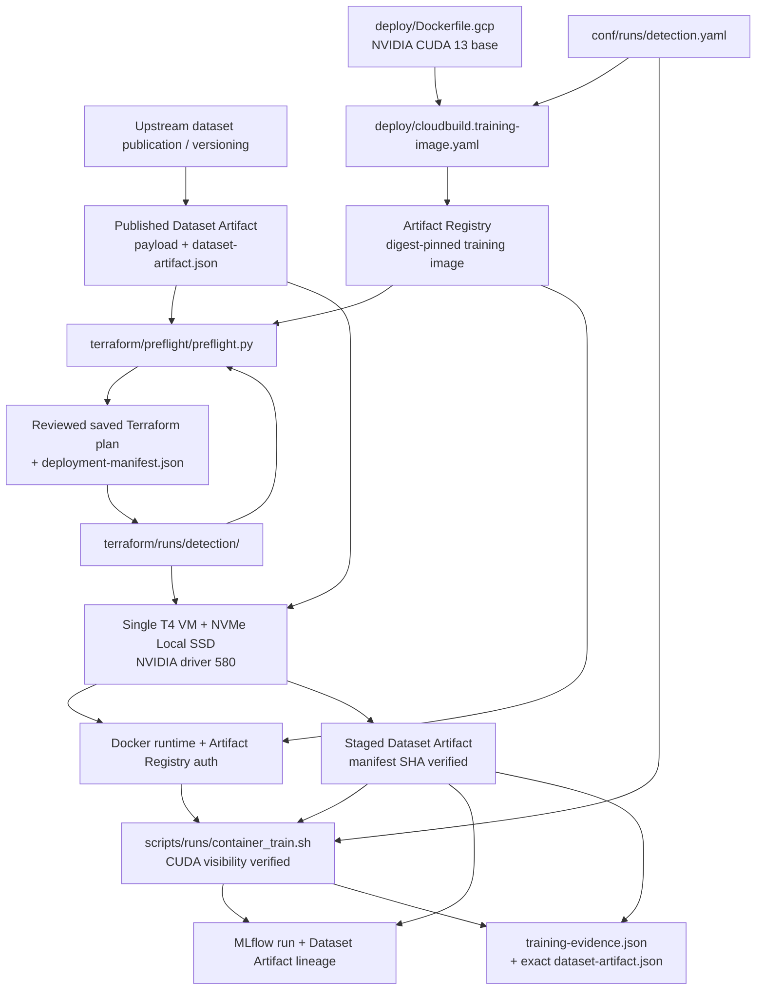

# Program Flow

For the distinction between reusable training behavior and concrete
Hydra/Terraform choices, read [Training architecture](training.md). The
training loop belongs in the library; this deployment flow does not make it
production-specific.

The library uses one loss-computation callable and one optimizer loop. Run-level
MLflow metadata, asynchronous epoch metric submission/completion, and selected
model publication are separated into `training/tracking.py`. Detection batching
and native-assigned loss computation are independent functions. See
[Training architecture](training.md#training-execution-contracts) for the
current call contracts; these changes do not alter deployment or Dataset
publication ownership.

Hydra selects common task execution and prepared DataLoaders. Built-in loss
functions preserve tensor/semantic outputs and native TorchVision, Hugging
Face, and Ultralytics training contracts. MLflow publication serializes the
selected native model without a project inference pass or tensor-only output
conversion; its format and optional examples/signatures are Hydra settings.

Inference consumes the published model through an MLflow URI (including
registered versions and aliases), loads it once with `build_predictor`, and
runs prepared batches through native PyTorch inference. Hydra selects device,
calling convention, forward options, and optional processors. Outputs keep
their provider's structure. See [Inference](inference.md) for the contract.

Training and inference share Hydra DataLoader construction in `data.loading`.
Native library datasets and custom human-annotation/distillation sources can
retain their own target structures. `Predictor.predict_dataset` explicitly
separates model inputs from labels and yields predictions with original targets
for accuracy scoring; input-only streams retain `predict_batches` semantics.
Dataset/collator and loss/metric choices define annotation interpretation.

## Training deployment

Scripts acquire or modify a Dataset only when the requested input is absent.
DVC registers each selected prepared Dataset independently through
`scripts/data/register.sh`: `dvc add` creates its sibling metadata file and a
targeted `dvc push` stores its contents. There is no fixed DVC preparation DAG
or broad ownership of raw/processed/augmented parent directories.

The cloud publisher still uploads the payload and manifest directly; connecting
that input to its durably preserved DVC version remains open work. See the
[Dataset guide](../guide/dataset.rst) for commands, inputs, outputs, and remaining
gaps. The GPU VM consumes the already-published Dataset Artifact and does not
run DVC or generate a replacement lockfile. `dataset-artifact.json` is the
provenance record across that seam.

The training image has one build path: `deploy/Dockerfile.gcp` through
`deploy/cloudbuild.training-image.yaml`. The digest-pinned NVIDIA CUDA 13 base
matches the CUDA major used by the locked PyTorch runtime; PyTorch supplies its
own locked CUDA/cuDNN user-space dependencies. There is no intermediate Feral
Vision base image and no run-specific training image.

Terraform owns the disposable VM lifecycle. Preflight validates the exact
saved plan and records its SHA-256 together with the training-image digest and
Dataset Artifact manifest SHA-256. `scripts/runs/detection.sh` applies only that
reviewed plan and waits for terminal training evidence.

After VM creation, startup proves host Docker/NVIDIA tooling, configures Docker
for Artifact Registry using the VM identity, pulls the exact digest, verifies
the Dataset Artifact, and confirms CUDA from inside the real training image.
VM creation or RUNNING status is not training success.

[Cloud Operations](cloudops.md) · [Terraform](terraform.md) ·
[Configuration](configuration.md) · [Training guide](../guide/training.rst)
