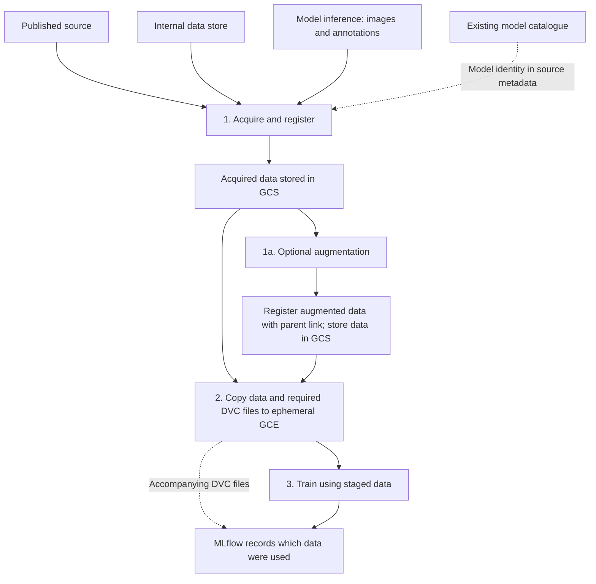

# Project data flow: agent reference

**Status: first draft, 2026-10-15.** This describes the user-defined lifecycle,
not a claim that the implementation already satisfies it. Read
[instructions.md](instructions.md) for the authoritative requirements and
verbatim clarifications. [dvc_commands.md](dvc_commands.md) records command
evidence; it does not define the lifecycle.

## How agents must use this reference

Use the user's instructions, especially this data flow, as context for every
analysis and relevance judgment. Do not derive project requirements from DVC
examples, cookbook workflows, or existing repository documentation. Do not
modify the user's requirements or add assumptions; ask when uncertain.

## Lifecycle and storage flow

Data are stored in Google Cloud Storage buckets. Training occurs on Google
Compute Engine in the same region. GCE instances are ephemeral. The
user-specified loading approach is to download to a storage bucket first, then
copy the selected data to the GCE instance for training to reduce load times.
Files are always copied to GCE. No load-time measurement is claimed
by this draft.

The diagram shows lifecycle relationships. It does not choose where acquisition
or augmentation executes, nor the timing of registration relative to individual
object writes.

### 1. Acquisition and registration

Acquisition from a published source or an internally created data store includes
registration. Each Dataset has a unique, one-to-one identifier. The identifier
must allow its root sources to be located.

Images and annotations may also be acquired through model inference. Register
these data with the producing model's identity in the source metadata. Use the
models' existing cataloguing system to maintain data integrity; the model
reference format is not selected here.

### 1a. Optional augmentation and registration

When augmentation is performed, register its result with a link to its parent.
The lineage must make the applied changes locatable for each data item. A link
to a tracked Dataset and the changes applied to each item is sufficient under
the user's requirements. Store the resulting data in GCS.

### 2. Staging on GCE

Copy the selected data from GCS to the ephemeral training GCE instance in the
same region. Copy the required DVC files with the data. The staging contract therefore
includes both the training data and the records required by the training and
MLflow step. This draft does not select a transfer command or a disk type.

### 3. Training and MLflow recording

Training uses the staged data. The user's lifecycle describes MLflow consuming
the accompanying DVC files to record which data were used for training.
"Individual record references" is descriptive, not a specification of file
format or granularity. The agent-introduced term "individual training record"
does not define a project concept.

The actual MLflow input contract must be established from MLflow documentation
and distinguished from project integration code. No requirement for one `.dvc`
file per image/annotation or for a `dvc.lock` follows from those phrases.

The user clarified that the artifact being logged is a DVC output. MLflow's
artifact API accepts a local file or directory; its contract does not prescribe
the internal DVC format. See the cited
[MLflow/DVC findings](mlflow_dvc_findings.md). A structured MLflow dataset input
is a separate API, not a prerequisite for logging this artifact.

The DVC output must be associated with the data used for training. Attaching
an arbitrary file to the same run does not establish that association. The
[external example investigation](mlflow_dvc_examples.md) distinguishes evidence
of actual loader inputs from examples that only log metadata files. The
[project source check](mlflow_dvc_findings.md#follow-up-association-in-the-inspected-project-code)
has not verified the DVC-output association in the current training path.

## Identity, lineage, and DVC's responsibility

DVC's project role is the catalogue of files. A file hash may identify contents,
but lineage must still be identified. Distinct names can remain distinct
catalogue entries even when their contents have the same hash.

DVC operations need source identifiers, such as unique filenames; they need not
encompass all details of the relationships. The workflow must nevertheless make
root sources and lineage locatable from the identifiers. Parent references and
model references participate in that lineage where applicable.

The record representation is still open. The descriptive wording does not
select one `.dvc` file per image or annotation, or a particular directory-index
representation.

## Existing documentation and implementation evidence

Existing guides describe a `dataset-artifact.json` publication/training handoff.
That description is not evidence that the accompanying DVC files reach training
or are consumed by MLflow. See
[program flow](../agents/program-flow.md) and
[data guidance](../agents/data.md) as existing descriptions to assess against
the user's lifecycle, rather than as replacements for it.

Whether a DVC CLI runs on a training instance is separate from whether required
DVC files accompany the data and are consumed for recording. This draft does
not impose a DVC CLI execution requirement.

## Questions for the next revision

1. Where does augmentation execute, and where are its registered outputs
   written before staging?
2. Which existing model catalogue reference identifies an inference model for
   source metadata?

Bucket names, the region, DVC record storage/layout, and the MLflow consumption
mechanism have not been selected in this draft. No cloud resources, transfers,
or training runs were executed to create it.
