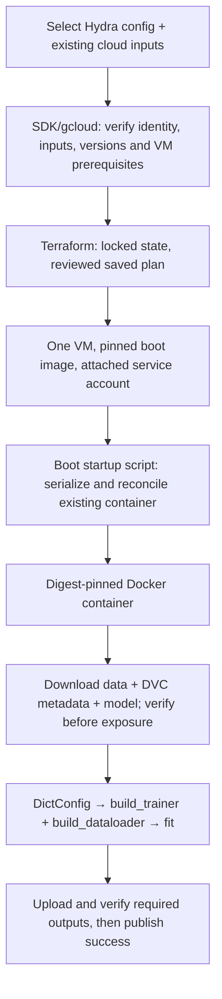

> Preserved reference material from the earlier design. The current training
> template is [here](../2026-10-17-google-cloud-review.md). Terraform/Docker
> sections may inform future setup work. The DVC staging proposal, specific
> inventory and deployment prerequisites below do not define the template.

# Google Cloud operations: fresh design

## Authority and scope

The user requires a design that minimizes VM crashes, duplicate resource
creation, and missing required cloud files. Errors may originate anywhere in
code, configuration, scripts, or package integrations. Checks that compare
those expectations with actual cloud resources must use Google SDKs or `gcloud`.

Design from these requirements and verified resource facts. Inherited code,
deployment recipes, manifests, and documentation describe existing behavior;
they do not establish what the new design must preserve. In particular, a name
in old code does not establish that a resource should exist or be created.

This document proposes behavior. No implementation or cloud mutation is part
of this work. Existing worktree changes remain independent of this design.

The concrete training design below incorporates the user's subsequent
requirements: Terraform creates the VM, a startup script launches Docker,
cloud data/DVC files/model are retrieved, and the library trains using Hydra.
The historical `feral-vision/conf/` collection is configuration material, not
one mandatory experiment. Library contracts in `src/sightkit_learn/config/`
define configuration structure. Conflicting inherited deployment restrictions
are observations about the old path, not requirements for this proposal.

## Verified cloud observations

Read-only `gcloud` checks on 2026-10-17 established the following, using the
project and dataset bucket configured in `.env.local`. Environment values and
credentials are intentionally omitted.

| Resource | What I verified | What remains unchecked |
| --- | --- | --- |
| Project | The configured display name resolves to one active project. | Permissions for the commands the program will run. |
| VMs | No Compute Engine instances in that project. The list limit was 50 and returned zero. | No running VM is available for hardware or startup verification. |
| Buckets | Two buckets: the configured dataset bucket and a Cloud Functions source bucket. The list limit was 50 and returned two. | Where future jobs should store their outputs and Terraform state. |
| Dataset bucket | Owned by the configured project; regional US-EAST4, STANDARD storage, uniform bucket access, public-access prevention enforced, versioning enabled, soft delete disabled. Raw metadata has no object-retention configuration. | Bucket metadata does not prove a future workload identity can read or write objects. |
| Published datasets | Two manifests under `datasets/coco/train2017/`, with suffixes `raw-20260806-800-animals` and `raw-20260806-800-animals-v2`. | Which Dataset a future job will use. |
| Dataset files | Each payload has 801 objects: 800 images and `annotations/instances.json`. Each annotation references 800 image names, all present in its payload. Lists were below the 5,000-object cap. | Presence is verified; image bytes and annotation semantics were not validated. |
| Container image | One image exists in the inspected `feral-docker/feral-vision-gcp` image path. | Whether this image can run the requested program on the selected hardware. |
| Default network | The inspected network is auto-mode. | Whether a VM using this network can reach the services it needs. |

Manifest and annotation reads used the generations observed through object
metadata. Existing manifests describe 801 payload files but do not supply
per-file hashes or generations. Neither counts nor a manifest's presence prove
the bytes of every input are correct.

## Existing failures that illustrate these risks

These findings describe existing behavior and its consequences. They are not
requirements to keep the existing workflow. Priority reflects the user's
reliability goals.

1. **P1: A completion marker can precede missing outputs.**
   [Startup export](../../../feral-vision/terraform/runs/detection/templates/trainer_startup.sh.tftpl#L64)
   uploads `training-evidence.json` before the other outputs, suppresses transfer
   failures, and returns the original workload exit code. A local harness
   executing that export function with a successful marker upload and failed
   output synchronization returned zero. A reader can observe FINISHED while
   required outputs are absent. Report success after checking the uploaded outputs, and
   report upload failures.
2. **P1: A previous execution's cloud record can be accepted as current.**
   [Evidence retrieval](../../../feral-vision/scripts/runs/detection.sh#L135)
   checks status and dataset hash without checking the record's run or image
   identity. A local harness executing the polling logic accepted FINISHED
   evidence with an old run ID and wrong image when the dataset hash matched.
   This is triggered by a reused output location containing an older marker.
   Check that the result belongs to the execution being checked; a matching
   Dataset hash is insufficient.
3. **P1: The publisher requests a capability absent from the configured bucket.**
   [The SDK publisher](../../../src/sightkit_learn/data/dataset_artifact.py#L82)
   unconditionally sets object retention before upload. The configured bucket's
   raw live metadata does not enable Object Retention Lock. Google's
   [object-retention contract](https://docs.cloud.google.com/storage/docs/object-lock)
   requires that feature before setting object retention. This is a verified
   prerequisite mismatch if this publisher targets that bucket, not a
   reproduced failed upload: no write was attempted. Determine the intended
   retention requirement and check capability before publication; do not
   assume a replacement bucket is required.
4. **P2: A partial publication cannot resume at the same prefix.**
   [Payload writes](../../../src/sightkit_learn/data/dataset_artifact.py#L79)
   always require that the destination not exist. A local SDK-call simulation
   saved the first object, failed the next upload, then failed the next attempt
   on the existing first object; the manifest remained absent. Google documents
   that [generation-match zero rejects an existing live object](https://docs.cloud.google.com/storage/docs/request-preconditions).
   This is a documented operational limitation, not proof of current cloud
   data loss. Verify and reuse identical completed objects on retries.
5. **P2: Concurrent builds sharing a tag can return the wrong build's image.**
   [The build script](../../../feral-vision/scripts/cloud/build_training_image.sh#L72)
   submits a build and subsequently resolves its shared tag. In a local
   simulation, the build identified image A, the tag lookup returned image B,
   and the script reported B as success. This requires another writer to move
   the tag between those calls; no such live race was observed. Resolve the
   result from the recorded build operation itself.

The same reviewed scripts are duplicated under `src/templates/`; byte
comparisons found those copies identical. No duplicate VMs or missing
annotation-referenced image objects were found in the live inventory. With no
VM running, this review cannot establish host/GPU runtime health or reproduce
a VM crash. A training-process failure is not evidence of a VM crash.

## What can fail?

- A command can use the wrong project, account, resource, or file version.
- A VM can lack the hardware, drivers, memory, disk space, or network access
  needed by the program.
- A timeout can hide a successful resource creation. Trying again with a new
  name can create a duplicate.
- A transfer can stop after copying only some files.
- A program can finish while its output upload fails, or a reader can mistake
  an earlier job's result for the current result.

These are failure cases to prevent. They do not require a new registry,
configuration system, or result-file format.

## What must be checked before proceeding?

Check the values the program will actually use. Do not copy them into a second
configuration or adopt resource names and settings from the old workflow.
Compare code, configuration, and script expectations with live resources using
Google SDKs or `gcloud`.

| Before | Check |
| --- | --- |
| Any cloud command | Confirm the project ID, account, resource name, and location. Check the identity that will execute the command; the operator and VM service account can have different permissions. |
| Creating a resource | Check whether the requested resource already exists. Compare the properties the program needs before reusing it. Stop if they differ. |
| Starting a VM job | Check the requested machine, GPU, disk, image, network, and available quota. Quota does not guarantee that hardware will be available. |
| Uploading files | Check the destination and required permissions. If the upload requests a bucket feature, such as object retention, check that the bucket supports it. Decide whether existing files may be replaced before choosing upload options. |
| Downloading inputs | List the files the program needs. Check that each exists, select its version, and verify its checksum after downloading. |
| Starting the program | Check the actual device, driver, container, mounted directories, free space, and required cloud access on the VM. |
| Reporting success | Check that the program succeeded and every required output file was uploaded. When reading a result, check that it belongs to the execution being checked. |

An object generation identifies a particular version of a Cloud Storage file.
An image digest identifies particular container-image content. A checksum
checks file content. Use these values where needed to prevent a file or image
from changing between a check and its use; they do not replace Dataset identity
or lineage.

A permission denial does not prove that a resource is missing. Report the
failed check with the expected and observed values. Read-only checks also
cannot prove that a future write will succeed. If a write test is necessary,
request authorization for that specific test.

## What happens after failure or interruption?

### Resource creation

After a timeout, check whether the requested resource was created before
trying again. Reuse the same resource name. If the API returned an operation
ID, use it to check whether creation finished or failed. Do not start a second
creation while the first result is unknown.

If concurrent execution is supported, use the creating tool's protection
against simultaneous changes. Specify that behavior for the actual resource
and tool during implementation; do not assume a general creation framework.
Terraform remains responsible for resource lifecycle where required by the
project. SDKs and `gcloud` check what exists in Google Cloud.

For a build, obtain the image digest from that build's result. Looking up a
shared tag afterward can return an image pushed by somebody else.

### File transfers

Keep partial downloads separate from files the program can use. Start the
program only when its required inputs are present and verified. Extra files
are an error only when they would break that program.

After a partial upload, check which files arrived. Before skipping or replacing
an existing file, compare its content and apply the agreed overwrite rule.
Retry missing transfers without silently replacing different content. Do not
publish a successful result while required files are missing. Do not delete
retained data or choose a new destination merely to escape a failed attempt.

### Program execution and output uploads

A running VM does not mean the program succeeded. Report success only after
the program finishes successfully and its required output files have uploaded.
When reading a result, verify that it belongs to the execution being checked.
Choose the necessary identifying fields when the actual workflow is defined;
this design does not prescribe a new result-file schema.

Keep command errors visible. Retry temporary failures only when repeating the
command is safe, with bounded retries and a deadline. Report where the failure
occurred. If saving logs also fails, report that failure without hiding the
original error.

If the VM disappears before its result is known, report that the result is
unknown. Check the VM and uploaded outputs before deciding whether to restart
or replace it.

## Checks for the implementation

Use small behavioral tests for the code that implements these rules, plus
Google SDK or `gcloud` checks against the actual resources:

1. A missing input, wrong file version, unsupported bucket feature, denied
   permission, or incompatible runtime stops the command that depends on it.
2. A timeout after successful creation does not cause a second resource to be
   created. Test simultaneous callers if the workflow supports them.
3. A failed middle transfer can resume according to the agreed overwrite rule
   without losing different content or reporting incomplete files as complete.
4. A previous job's result is rejected, and a failed output upload prevents
   success. A missing VM does not trigger blind replacement.
5. A successful case checks required inputs, the running program's environment,
   and uploaded outputs separately.

These tests have not been implemented or run. The live checks above establish
resource facts only. VM hardware, write permissions, downloaded image bytes,
and retry behavior of a new implementation remain unchecked.

## Concrete training design

### Fresh checks in this session

Read-only `gcloud` checks on 2026-10-17 reconfirmed one active configured
project, one active human CLI identity, zero VMs (limit 50), and an existing
training image through `check_training_image.sh`. Image existence does not
establish compatibility. No image build was attempted.

The bucket inventory returned two buckets (limit 50): the configured dataset
bucket and a Cloud Functions source bucket. No operations bucket was present
in this project's inventory. This does **not** require creating the operations
bucket named by old Terraform. State/output destinations must be selected
deliberately; an authorized bucket in another project remains possible.

The configured dataset bucket is owned by the resolved project, in US-EAST4,
with versioning enabled and no Object Retention Lock configuration. A complete
live-object listing returned 1,606 objects, below its 10,000 cap, including:

- 1,602 payload objects across the two existing Dataset prefixes;
- two `dataset-artifact.json` files;
- one `dataset-artifact.dvc` under the `-v2` Dataset prefix;
- no model candidates by common model suffixes (`.pt`, `.pth`, `.safetensors`,
  `.onnx`, `.bin`) or `model/` and `models/` prefixes.

Filename classification is not proof that no model exists under another name,
generation, bucket, or project. A generation-pinned read of the live `.dvc`
record succeeded: 97,917 characters, with two output paths (a cloud payload
and `dataset-artifact`). A text check found neither a native MD5 `.dir` hash
nor a top-level `meta:` mapping. This is not a full DVC parse or proof that
the record is invalid; its content association and provenance remain unverified.
There is no verified cloud model input or complete data/DVC handoff yet. A new
VM must not be created just to discover these missing prerequisites.

### Execution and ownership



The production shell launcher owns selection and Terraform invocation. Small
Python deployment functions use Google SDKs for cloud checks and transfers;
Python does not shell out to a CLI. Terraform owns VM lifecycle, including
removal. The host startup script owns Docker invocation and supervision. The
container entrypoint stages inputs and calls reusable library training. DVC
metadata retains Dataset identity and provenance; MLflow retains run/model
evidence. Terraform, DVC, and MLflow do not substitute for one another.

Only the VM and its necessary attached disk are job-created resources in this
design. Reference existing network, service account, registry and input storage
after checking their suitability. Do not create shared infrastructure because
an old variable or backend names it. Any genuinely missing shared prerequisite
gets a separate explicit decision before provisioning.

### Select and validate the actual configuration

Accept an explicit Hydra config directory, selected config name and overrides.
Register the schemas in `config/store.py`, compose the selected configuration,
and validate the used groups against their structured contracts. Do not require
every historical config to compose or every inference/augmentation field to be
populated for training. Resolve interpolations and mandatory training fields
before provisioning; repeat in the exact training image with staged paths.
Archive the selected config closure and overrides so later edits to the config
collection cannot change this execution. Keep secrets out of these artifacts.

The object is OmegaConf **`DictConfig`** (the user's “ConfigDict”), not a new
configuration type. Preserve it through library calls. Key contract seams:

| Contract | Consequence |
| --- | --- |
| `DataConfig.root`; `TrainConfig.dataloader` and `collate_fn` | Bind the selected reader to the verified Dataset root. With an explicit loader, setting `data.root` alone does not prove the loader uses it. |
| `ModelConfig.architecture`; optional `weights` | Stage the complete model package required by its selected provider, including configs/tokenizer/processor files where applicable. A weight file alone need not suffice. |
| `TrainConfig.task`, `loss_mode`, `optim`, optional criterion/scheduler | Validate the selected model/batch/loss combination through actual library execution. Do not fix detection, class count or optimizer from prior recipes. |
| `TrainConfig.device`, batch size, workers | Keep user training choices explicit; reject an unavailable device rather than silently changing it. |
| `TrackingConfig`; `best_model_path` | Put tracking files and the checkpoint under the mounted writable output directory. A relative default must not strand outputs inside the container. |

[Hydra's compose API](https://hydra.cc/docs/advanced/compose_api/) returns
`DictConfig`; it is also suitable for composing the selection without executing
training. Schema registration alone does not validate an arbitrary YAML that
never merges a schema. Test that unknown keys/types and required missing
training values are rejected before any VM creation.

### Cloud inputs and the data/model handoff

Before plan/apply, use Google Storage SDK reads to resolve each selected object
to bucket, name, generation, size and checksum. Verify actual object access
under the intended VM identity where impersonation is available; otherwise
report operator-only evidence and retain the runtime check. A 403 is an access
failure, never permission to create a replacement resource.

The necessary inputs are the selected config closure, Dataset contents,
original `.dvc` record and native directory index where applicable, retained
provenance, and the selected model package. Keep Dataset ID, provenance,
DVC content hash, GCS generation and transport checksums distinct. Do not
manufacture lineage from a new `dvc add` on the VM.

Stage into a sibling temporary directory. Fetch pinned generations using the
Storage SDK with checksum checking, bounded retries and a deadline; reject
unsafe destination paths. Validate the original DVC record/index against all
staged filenames and bytes, plus the selected reader's annotation contract.
Expose the completed directory atomically and mount verified inputs read-only.
Preserve the original record/index and the exact loader root in run evidence.
The association to test is **selected DVC record → matching contents → actual
loader input**, not just a logged hash.

`data_flow_rewrite.stage/verify` is an existing independent, locked staging
candidate, not an automatically adopted runtime dependency. Its current
handoff includes `dataset/`, `dataset.dvc`, and `dataset.dir`; integration must
prove that its selected GCS snapshot and payload are present. If used, package
its pinned environment explicitly and keep it outside the released library.
All comparisons with actual cloud object availability still use Google SDKs
or `gcloud`. DVC verifies the record-to-content relationship after retrieval.

Inspect the selected adapter before binding model paths. Current
`UltralyticsAdapter.fetch` reads `architecture.id`; setting `weights.location`
would not load the staged model. The local architecture builder does not
generically apply `WeightsConfig`; Torch Hub still calls `torch.hub.load`.
HF local loading requires all named files, otherwise it can download them.
Use a demonstrated local load path for the selected provider, or fix that
specific library seam and test it. Forbid unplanned hub downloads during the
acceptance run. Do not invent a universal model wrapper.

### Terraform beachhead and startup

Choose VM RAM, GPU/VRAM, vCPU and disk from the selected job and measured
runtime needs, not old names. Prefer on-demand capacity and a persistent disk
workspace for the first implementation: Local SSD and first-boot filesystem
formatting are not needed to establish training. Account for compressed image
layers plus extracted layers, staged inputs, temporary downloads, checkpoints
and bounded logs. Verify quota and zone/machine/GPU compatibility through
Compute SDK reads; quota alone cannot guarantee allocation.

Pin the boot image and container digest. For this first version, disable
automatic VM restart and self-deletion; interruption needs explicit recovery
and output reconciliation. Verify the boot image's guest agent,
Docker daemon, GPU driver and NVIDIA container runtime prerequisites. Do not
install or upgrade GPU drivers concurrently with startup/training. Check an
actual GPU tensor operation inside the selected container before full loading.
Set a container memory limit below available host RAM, allow for worker/shared
memory use and bound Docker log rotation; record OOM and disk exhaustion as
distinct failures. Keep network/boot/runtime readiness waits bounded.

Use one stable VM name and Terraform resource address for the job, one canonical
state location and locking. The [GCS backend supports locking and requires an
existing bucket](https://developer.hashicorp.com/terraform/language/backend/gcs).
Backend selection is still open; never silently fall back to a second state
store. Apply only the reviewed saved plan. Reject unexpected creates,
replacements or deletes. On timeout, reconcile the cloud operation, exact
instance and Terraform state before retrying; do not change the name or zone.
An existing unmanaged instance requires explicit ownership reconciliation,
not automatic deletion or silent adoption. Do not use `create_before_destroy`
for this single-job VM.

Use one inline metadata startup script, launched by the guest agent, with an
exclusive host lock. It waits for Docker/network, authenticates registry access
as the attached service account, pulls the selected digest, and reconciles a
deterministically named container and its job/config/image identity:

| Existing state | Startup action |
| --- | --- |
| No container, no previous training start | Create and start once. |
| Matching created container, no training-start marker | Finish verified setup and start it once under the lock. |
| Matching running container | Observe it; do not launch a second one. |
| Matching exited container, training completed | Retry pending output export; never rerun training. |
| Exited failed container, or training-start marker without known completion | Report failure/interruption for explicit recovery; do not silently restart. |
| Container or retained job identity differs | Stop with a conflict. |
| No container but a previous training-start marker | Report interrupted/unknown; do not recreate it automatically. |

Retain the container, its exit code and logs until durable publication is
verified. Use Docker restart policy `no`, with no competing host restart loop.
Docker documents that `always` restarts completed containers and warns against
two restart owners. Compute startup scripts run on boot, so serialization and
retained state are necessary even with Docker restarts disabled. See the
[verified startup sources](../sources/2026-10-17-google-cloud-review.md).

Use exec-form Docker `ENTRYPOINT`; after staging, its shell uses `exec` into
Python so training receives termination signals. The **host** supervisor
retains responsibility for waiting, inspecting exit/OOM state and exporting
outputs. An EXIT trap in a shell replaced by `exec` cannot perform that export.
Keep run state on persistent storage and record training-start before launch.
If interruption occurs in that transition, conservatively report unknown and
require recovery. This prevents duplicate execution at the cost of manual
recovery; it is not a promise of exactly-once execution across disk loss.

### Training and completion

After verified staging and config binding, invoke the existing library seam:

```python
trainer = build_trainer(cfg)
train_loader = build_dataloader(cfg)
history = trainer.fit(train_loader)
```

These functions live in `src/sightkit_learn/training/trainer.py`. Config
composition and deployment staging stay outside the training loop. Confirm
that the constructed model loaded the selected cloud bytes and that the
DataLoader reads the verified root. Fail before full training if the dataset
is empty, labels/model outputs disagree, or the selected native loss cannot
perform a forward/backward/optimizer step.

Store checkpoints, resolved config, original DVC metadata/provenance, source
object versions, model identity, metrics and logs in the writable run output
directory. Periodically upload completed checkpoints/logs with atomic local
checkpoint writes; this limits loss if the VM disappears. A best-weights file
does not establish full optimizer/scheduler/RNG resume support. Automatic
resume is outside this first design until that contract exists and is tested.

Upload required outputs first, then verify their remote generations, sizes and
checksums using the Storage SDK. Publish terminal success last with a
create-only generation precondition. Existing identical outputs can be reused;
different content is a conflict. A failed export is a failed publication even
when training exited zero. The completion reader checks job/attempt identity,
config hash, image digest, Dataset identity/record and model identity. A prior
job's result cannot satisfy this job. VM disappearance without verified
completion remains unknown. Keep failed-run diagnostics and avoid automatic
VM deletion before output verification; Terraform cleanup is a separate
reviewed operation.

### Load-bearing acceptance tests

These are implementation acceptance criteria, **not tests claimed to pass**.
Tests must execute the production launcher/startup/staging/training functions;
they must not copy those functions into a harness or assert source strings.
Mock only external APIs for deterministic fault injection, using their real
signatures. Add a small real container integration and a bounded live GPU run.

| Test and injected failure | Required observable result |
| --- | --- |
| Compose two substantially different valid selections; invalid type/key and missing optimizer | Valid selections remain distinct DictConfigs; invalid selections fail before Compute insert/apply. |
| Remove selected model, DVC record/index, annotation or referenced image; deny one read; replace an object after selection | No training starts. Error names the failed input/version/access check; no replacement resources are created. |
| Corrupt one staged image but retain the manifest/hash; point explicit loader at a different root | DVC verification or handoff test fails. Logging metadata alone cannot make this pass. |
| Load staged model with external hub access disabled; substitute different model bytes | Actual provider loads the intended package; wrong bytes fail validation. A small 2D batch produces finite loss, nonzero gradients and a changed parameter through the real library loop. |
| Run startup twice, concurrently, and after successful completion | Exactly one training execution; later invocations observe it or finish publication only. |
| Simulate lost create response after cloud insertion; invoke launcher again | One VM under the same identity/state; pending operation reconciled; no second name/zone chosen. Also test competing launchers against the canonical lock. |
| Kill training, restart Docker, exhaust container memory, or fail the GPU probe | No uncontrolled retraining; host remains observable where possible; failure/interruption is surfaced and success is absent. |
| Fail an intermediate download or output upload, then retry | No partial input becomes loader-visible; identical outputs resume; different outputs are not overwritten; success appears only after required uploads verify. |
| Reuse a prefix containing another attempt's successful marker | Reader rejects it despite matching Dataset content. |
| Bounded live GPU job with selected GCS inputs and attached VM identity | SDK/gcloud establishes resource/input facts; actual container loads cloud model/data, trains, checkpoints and publishes verifiable outputs. A second apply has no creates. |

Each fault test must fail when its corresponding guard is removed. A Terraform
mock plan checks wiring, not cloud existence, permissions or GPU readiness.
Import checks, VM RUNNING status, and Docker startup alone are not training
acceptance evidence.

### Implementation reach and remaining decisions

Change the production Terraform root/startup template, shell launcher and
container entrypoint together. Remove their fixed recipe assumption; update
the Docker build to package the library and needed runtime tools without
validating the entire historical config collection as one experiment. Wire
SDK input/output helpers and reuse the library training functions. Touch a
model adapter only if the selected cloud model lacks a correct local load seam.
Update corresponding starter assets when behavior is intended for generated
projects, the focused tests, and canonical cloud/config/training guides.

Do not begin a paid VM attempt until the selected training config, exact cloud
model package, verified Dataset/DVC association, intended VM identity,
state/output storage and measured machine requirements are established. These
are unresolved deployment inputs, not reasons to create resources named in
old files. No VM, write probe, Terraform apply or GPU training was run for this
design. Guide-impact review: this change documents a proposal and does not
change the currently executable operator workflow.
